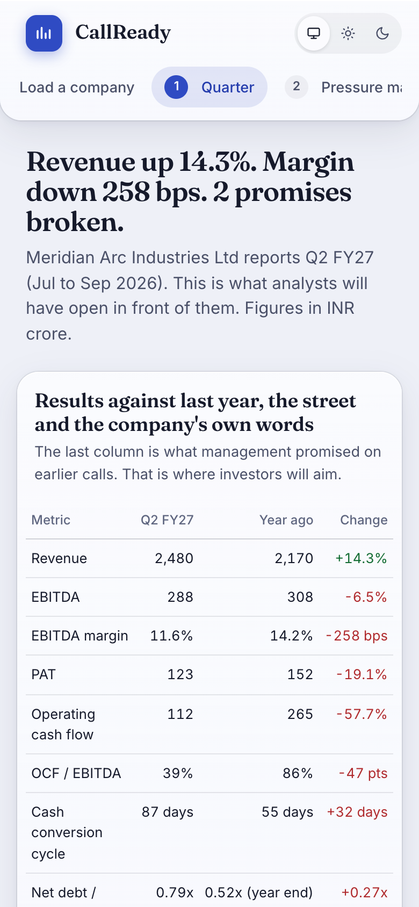
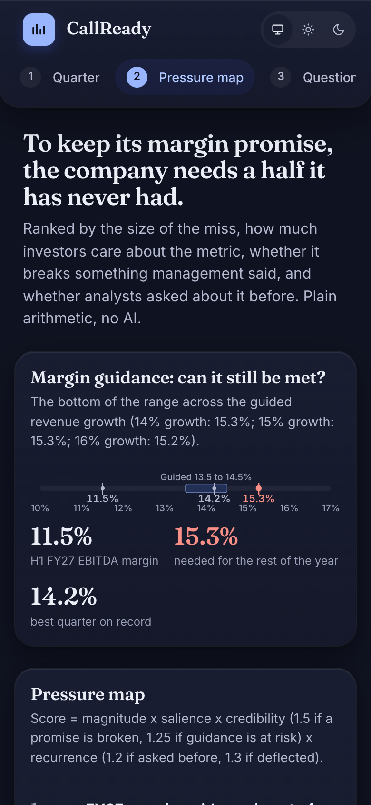
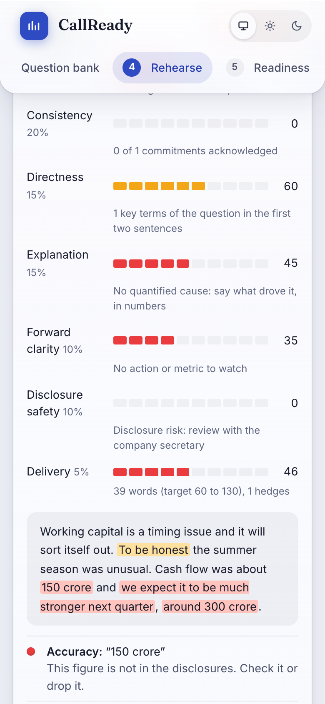
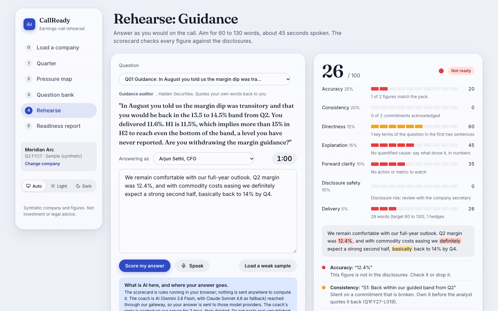
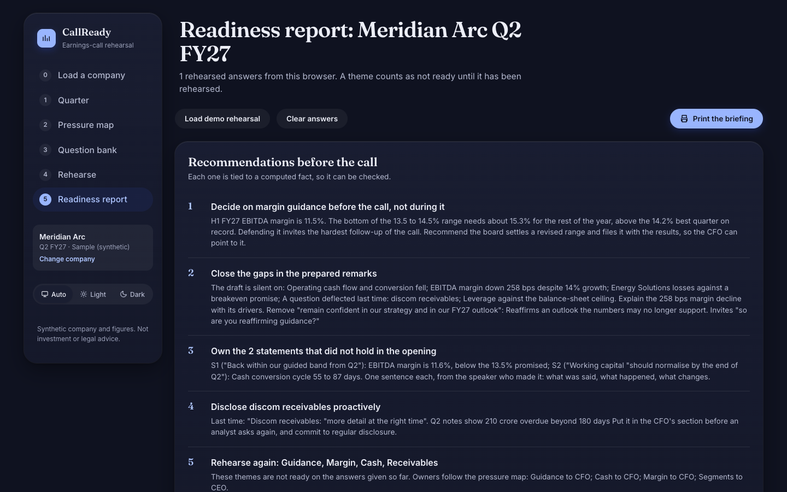

# CallReady

**Is the leadership team ready for tough investor questions?** CallReady rehearses a listed company's earnings call against the company's own disclosures. Upload the quarter's results, or pick a real company from the test datasets. CallReady ranks what investors will push on, writes the questions they will ask, and scores each rehearsed answer for accuracy, consistency with past promises, and disclosure safety. It ends in a readiness report with recommendations to act on before the call.

> **Retired on 2026-10-29.** CallReady was a competition prototype and its purpose is done. The live site and API are shut down and this repository is archived (read-only). The final report, lessons learned and how to revive it are in [docs/09-CLOSEOUT.md](docs/09-CLOSEOUT.md).

**[Demo video](https://www.tella.tv/video/surviving-earnings-day-0dxghs83)** · Made by [Krishnendu](https://krishnendu.me) · [Changelog](CHANGELOG.md) · [Governance (PMI-CPMAI)](docs/08-GOVERNANCE.md) · [90-second pitch](docs/07-PITCH.md)

## Screenshots

<p>
  
  
  
</p>
<p>
  
  
</p>

Every screen: [docs/screenshots/](docs/screenshots/). A captioned backup video of the pitch path can be regenerated with `node scripts/record_demo.mjs`.

## What it does

| Step | Screen | What happens | Rules or AI |
| --- | --- | --- | --- |
| 0 | **Load a company** | The synthetic sample, one of six real companies, an uploaded results PDF or text, or a pack in the JSON format | AI converts uploads; **rules verify every figure and quote against the source** |
| 1 | **Quarter** | Results against last year, consensus and the company's own earlier words; revenue and margin trends; segment margin change; margin bridge | Rules |
| 2 | **Pressure map** | What investors will push on, ranked. Includes the margin needed for the rest of the year to meet guidance, and a gap check on the prepared remarks | Rules |
| 3 | **Question bank** | Analyst questions by theme and persona, each with its trap and its source | Rules (templates) or hand-written |
| 4 | **Rehearse** | Type or speak, with a live word count and the speaking time it implies. A seven-dimension scorecard, every figure checked, risky phrases marked. The coach adds a critique, a stronger answer and the analyst's follow-up | Rules score; **AI coaches**, and rules re-check the coach |
| 5 | **Readiness report** | Readiness by theme and speaker, the riskiest questions, contradictions between speakers, recommendations, and an editable business case | Rules |

**The design rule is that a model never computes a figure.** Arithmetic, ranking, commitment status and scoring are plain code (`web/js/core.js`, `web/js/score.js`). AI does two things only: it turns documents into the pack format and it writes coaching. Its output is checked by the same rules before anyone sees it.

## Test datasets: real filings

Real Q2 FY27 results from NSE and company filings, converted by the same pipeline as an upload and verified by rules against the source text. Use them from **Load a company**.

| Company | Sector | Figures verified | Quotes verified | Notes |
| --- | --- | --- | --- | --- |
| Wipro | IT services | 34/34 | 2/2 | Reports operating margin, not EBITDA. Rules flag that the extracted segments double-count |
| Jindal Saw | Steel pipes | 17/17 | 0/4 | Margin pressure. The AI paraphrased all four quotes, and the rules caught it |
| Tejas Networks | Telecom equipment | 16/17 | 5/5 | Loss-making, three questions deflected on the call |
| Pitti Engineering | Engineering | 13/13 | 1/1 | Revenue +21%, margin and PAT down |
| JK Tyre | Tyres | 12/12 | none | Margin -624 bps, PAT -73% |
| Nestle India | FMCG | 18/20 | 5/7 | A healthy quarter, for contrast |

**Round trip on the synthetic sample.** `scripts/make_sample_pdf.mjs` turns the sample into a results PDF. Uploaded on the live site, the extraction matched **48/48 fields** against the true values, and the rules found 50/50 figures, 7/7 quotes and 14/14 transcript lines in the source.

## Run it locally

The web app has no build step.

```sh
node scripts/serve.mjs                    # http://127.0.0.1:8731, no-store so a reload runs the code on disk
```

Every screen works without the API: the scorecard is rules in the browser, and the coach falls back to reference answers. The upload converter and the live coach need the API:

```sh
cd api && uv sync
LLM_BASE_URL=http://127.0.0.1:20128/v1 LLM_API_KEY=... uv run uvicorn callready.main:app --port 8140
```

## Environment

Every API variable is listed in [`.env.example`](.env.example): the gateway URL and key, the model chain, the daily and per-client caps, and the 7-day retention. The web app needs two Vercel env vars, `BACKEND_ORIGIN` and `BACKEND_KEY`, which its functions use to reach the API. The browser never sees them. Vercel's Git integration deploys `web/` on every push to `main`, and builds a preview for every pull request.

## Architecture

```
Browser ─ Vercel: static site (ES modules) + functions /api/coach, /api/extract, /api/health
                    └─ API on a VPS (FastAPI on loopback, published through a tunnel, shared key)
                         └─ OpenAI-compatible gateway: Gemini 3.8 Flash (tier per job), Claude Sonnet 4.6 fallback
```

Extraction runs as a background job that the browser polls. Coach and extraction results are cached and deleted after 7 days. Calls are capped per client and per day. `/health` reports which model answered, the fallback rate, latency and cache hit rate. Details: [docs/02-ARCHITECTURE.md](docs/02-ARCHITECTURE.md).

## Commands

| Command | What it does |
| --- | --- |
| `node scripts/check_engine.mjs` | Data-readiness and scoring-calibration gate: the pack reconciles, statuses and ranking are right, reference answers are Green, planted errors are caught |
| `node scripts/check_bias.mjs` | The scorer does not penalise plain or Indian-English phrasing (within 10 points) |
| `node scripts/check_guardrails.mjs` | Pack sanitiser, financial sanity rules, units and consistency, evidence policy, upload limits (60+ checks) |
| `node scripts/check_xss.mjs` | A hostile pack on every screen: no payload may run (detector proven by a canary) |
| `node scripts/check_layout.mjs` | 6 screens x 7 companies x 2 sizes: no overlapping text, spills or sideways scroll |
| `node scripts/check_content.mjs` | What a person reads on every screen: no empty options or labels, stray punctuation, straight quotes or NaN |
| `node scripts/check_charts.mjs` | Chart truth on every screen and 1,500 random charts: every mark at its value, cut axes marked and said, round ticks with units |
| `cd api && uv run pytest -q tests` | API guardrails: key, limits, per-client caps, output caps, retention, untrusted-input rules |
| `node scripts/export_pack.mjs` | Exports the sample's facts for the API, so the coach and the UI use the same numbers |
| `node scripts/make_sample_pdf.mjs` | Builds the sample company's results PDF for round-trip tests |
| `node scripts/test_extract.mjs <doc.txt>` | Runs a document through the live extractor and reports verification and field accuracy |
| `node scripts/warm_demo.mjs` | Warms the coach cache for the pitch path |
| `node scripts/screenshots.mjs` | Recaptures the screenshots from the live site |
| `node scripts/record_demo.mjs` | Records the captioned 90-second demo video |

CI runs every gate on every push: rules, guardrails, and XSS, content, layout and chart truth in headless Chrome, the API tests, and a secret scan ([.github/workflows/ci.yml](.github/workflows/ci.yml)).

## Guardrails

Every path by which untrusted data enters (uploads, JSON packs, AI output, answers, API callers) passes four layers, each with tests: sanitising on entry, financial sanity rules, escaping at render, and a Content-Security-Policy. On the API: a shared key, size limits, per-client and daily caps, output caps, 7-day retention, and prompts that treat answers and documents as untrusted data. The plan, built test-first with the [superpowers](https://github.com/obra/superpowers) methodology: [docs/superpowers/plans/2026-10-28-guardrails.md](docs/superpowers/plans/2026-10-28-guardrails.md).

## Data and assumptions

1. The sample company, Meridian Arc Industries, and every figure in it are synthetic. They are built to reproduce the brief: revenue up, margins and cash down, segments diverging, earlier promises broken. The test datasets are real public filings; their source links are in [web/datasets/index.json](web/datasets/index.json).
2. Indian listed companies: SEBI listing and insider-trading rules frame what may be said on a call.
3. Pressure weights and score thresholds are judgement calls from earnings-call practice, not fitted to data. Scores rank answer quality against a rubric; they do not predict the share price. Disclosure flags are prompts for the company secretary, not legal advice.
4. The business case on the Report screen is built from editable assumptions, and is labelled as such.

## Key limitation

**Data trust.** A finance team rehearses in the days before results are announced, when its figures are unpublished and price-sensitive. CallReady's AI features (converting documents the rules cannot read, and the coach) send text to outside model providers through our gateway, so a listed company's compliance team would not approve using them on unpublished results. The upload screen says so: published documents only. The rest of the product (reading results tables, every figure check, the pressure ranking, the question bank, the scorecard and the charts) runs as rules in the browser and sends nothing. The way forward is to run the models inside the company's own cloud account, or with the AI switched off, since the rules-only path already works end to end.

Other limitations, in order of weight: it has not yet been proven on real calls (the scorer is calibrated on answer pairs we wrote, and the time saved is an assumption); it checks numbers, not narrative (a claim without a figure, or a question about strategy or governance, goes unchecked); and it sees only the company's own figures, not its peers'.

## Documentation

- **Close-out (retired 2026-10-29):** [docs/09-CLOSEOUT.md](docs/09-CLOSEOUT.md) · **Handoff:** [docs/11-HANDOFF.md](docs/11-HANDOFF.md) (state, gates, workflow, backlog) · [Edge cases](docs/10-EDGE-CASES.md)
- [PRD](docs/01-PRD.md) · [Architecture](docs/02-ARCHITECTURE.md) · [Data](docs/03-DATA.md) · [Scoring](docs/04-SCORING.md) · [Roadmap](docs/05-ROADMAP.md) · [Decisions and risks](docs/06-DECISIONS-RISKS.md) · [Pitch](docs/07-PITCH.md) · [Governance](docs/08-GOVERNANCE.md)
- [Contributing](CONTRIBUTING.md) · [Security policy](SECURITY.md) · [Code of Conduct](CODE_OF_CONDUCT.md) · [Agent rules](AGENTS.md)

## License

[MIT](LICENSE).

## Credits

- Made by [Krishnendu](https://krishnendu.me).

- Governance framework: the PMI Certified Professional in Managing AI (PMI-CPMAI) exam content outline (September 2025).
- PDF reading: [pdf.js](https://mozilla.github.io/pdf.js/) by Mozilla.
- Test data: public Q2 FY27 filings by Wipro, Jindal Saw, Tejas Networks, Pitti Engineering, JK Tyre and Nestle India, from NSE and the companies' own sites. CallReady is not affiliated with any of them, and the extracted packs are for testing only.

_Last true: 2026-10-29_
